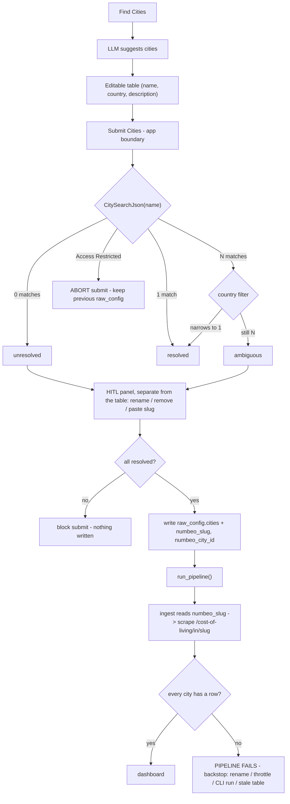

# Spec: Human-in-the-loop city resolution for Numbeo

## Objective

Resolve every configured city to the slug Numbeo actually keys it under, at the moment the city is submitted, so the cost-of-living ingest stops failing on names Numbeo spells differently.

The app derives the Numbeo URL by replacing spaces with dashes (`build_city_url`, `pipeline/lib/numbeo.py`). That rule is wrong in both directions:

| App name | Naive slug | Numbeo's slug |
|---|---|---|
| Tel Aviv | `Tel-Aviv` (error page) | `Tel-Aviv-Yafo` |
| St. Petersburg | `St-Petersburg` (error page) | `Saint-Petersburg` |
| Washington, DC | `Washington-DC` (error page) | `Washington` |
| The Hague | `The-Hague` | `The-Hague-Den-Haag-Netherlands` |

When a city does not resolve, `raw_numbeo.cost_of_living` has no rows for it and the `every configured city has cost of living` check (`pipeline/assets/core/cost_of_living.sql`) fails the whole pipeline. A hardcoded alias map (`SLUG_OVERRIDES`) does not scale, because both the LLM and the user introduce arbitrary city names.

The user is one person, the project owner. No authentication, no multi-tenancy.

Success: a user can submit any city Numbeo knows and it resolves, with no alias map to maintain and no city silently missing from the dashboard.

## Assumptions

Stated up front; correct them before planning.

1. **`raw_config.cities.name` stays the identity key end to end.** It feeds the earnings prompt, the numbeo row stamp, and the check join. The slug is an attribute of the row, never a rename. `clean__numbeo_cost_of_living.sql:20` does `replace(city, '-', ' ') as city_name`, so a slug written as `city` would corrupt the join.
2. **Resolution runs in the Streamlit app at Submit**, not inside the ingest. The ingest runs headless (CLI, container, tests) and cannot prompt.
3. **Numbeo's `CitySearchJson` and `dispatcher.jsp` are acceptable dependencies**, even though they are undocumented and the dispatcher's redirect is malformed.
4. **The pipeline keeps its hard-fail check.** A city that cannot be resolved is never written, so the check only fires on genuinely stale or external data.
5. **Streamlit is the only writer of `raw_config`**; the pipeline reads it read-only.
6. **`SLUG_OVERRIDES` and the naive slug stay** as a pipeline fallback for rows that predate the new column, or that arrive from outside the app.

## Baseline

- `raw_config.cities(name, country, description)` is app-owned and replaced wholesale on every Submit (`streamlit/utils.py`, `save_config_to_duckdb`).
- The flow today: LLM suggestions -> `session_state.city_suggestions` -> editable `st.data_editor` -> "Submit Cities" -> save -> `run_pipeline` (`streamlit/Home.py:114`, `:123-128`, `:131-150`). Suggested and hand-added cities both pass through the same Submit.
- The ingest reads `select name from raw_config.cities` and calls `get_city_data(name)` (`pipeline/assets/ingest/numbeo.py`).
- `get_city_data` already logs the URL and page title when there is no table (`pipeline/lib/numbeo.py`), which is how the Tel Aviv failure is diagnosable at all.

## Resolution flow

HITL and the hard-fail are not alternatives; they sit at opposite ends of one flow. HITL runs at Submit, before anything is written, so an unresolved city never enters `raw_config`. The hard-fail runs later, in the pipeline, and is the backstop for a city that was fine at Submit and stops resolving afterwards.



The HITL panel answers "is this city resolvable now". The check answers "did everything still resolve at run time".

## Tech Stack

Unchanged: Streamlit, DuckDB at `$DUCKDB_LOCATION`, the pinned Bruin CLI, pytest. No new Python dependency - Numbeo is called with the `requests` already in use.

Numbeo contract to build against (verified; do not re-probe, it rate-limits):

- `GET https://www.numbeo.com/common/CitySearchJson?term=<query>` -> JSON array of `{"label": "<City, Country>", "value": "<city_id>"}`. Multiple matches are possible (`"Washing"` -> Washington DC, Washington MI; `"London"` -> UK, Canada).
- `GET https://www.numbeo.com/common/dispatcher.jsp?city_id=<id>` with redirects **not** followed -> a 302 whose `Location` is `https://www.numbeo.com<slug>` (missing the slash, but the slug segment is canonical).

## Commands

```bash
export PATH="$HOME/.local/bin:$PATH"
export DUCKDB_LOCATION=database/dwh.duckdb

make test                       # uv run pytest tests, also a pre-commit hook
make fmt                        # sqlfmt over pipeline/
bruin validate pipeline
bruin run pipeline --workers 1  # DuckDB allows a single writer
uv run streamlit run streamlit/Home.py
```

## Project Structure

```
pipeline/lib/numbeo.py            + search_cities, canonical_slug, resolve_city;
                                    get_city_data(city, slug=None) prefers a stored slug
streamlit/utils.py                + load_city_slugs, resolve_city_rows, apply_resolution
streamlit/Home.py                 Submit gate: resolve, then happy path or HITL panel
streamlit/prototypes/numbeo_hitl_prototype.py   throwaway HITL mock (no API, no LLM)
pipeline/assets/ingest/numbeo.py  read name + numbeo_slug, pass the slug through
tests/test_costofliving.py        resolution: 0/1/N matches, country filter, fallback
tests/test_app_smoke.py           the Submit gate's happy path and its HITL path
raw_config.cities                 + numbeo_slug TEXT, numbeo_city_id TEXT
```

Unchanged: `clean__config_cities.sql`, `core/cost_of_living.sql` (the check stays), the earnings ingest, the Comparison page.

## Code Style

All Numbeo knowledge stays in `pipeline/lib/numbeo.py`, network-free at import, with the fetcher injected so tests never touch the network - the pattern already used by `get_city_data`.

```python
def resolve_city(name, country=None, fetch=None):
    """Return a Resolution: exactly one match, several, or none.

    Numbeo's own search is the only source of truth for the slug; deriving it
    from the label is unsafe ("The Hague" -> "The-Hague-Den-Haag-Netherlands").
    """
    matches = search_cities(f"{name}, {country}" if country else name, fetch=fetch)
    if not matches:
        matches = search_cities(name, fetch=fetch)  # LLM country may not match Numbeo's
    ...
```

The slug is fetched lazily, only for the chosen id, so an ambiguous city with four candidates costs one dispatcher call, not four.

## Testing Strategy

pytest, `make test`, no network. Extend the existing injectable-fetch tests in `tests/test_costofliving.py`:

- `search_cities` parses the JSON; `canonical_slug` parses the malformed `Location` defensively.
- 0 matches -> unresolved; 1 match -> resolved; N matches -> ambiguous, and the country filter narrows it to one.
- `get_city_data` prefers a stored slug and falls back to the naive slug + `SLUG_OVERRIDES`.
- The app gate: an all-resolved submit keeps the existing happy path; an ambiguous or unresolved row renders the HITL panel and does not write until confirmed.

## Boundaries

**Always**
- Keep `name` the identity; carry the slug as a separate column.
- Keep the fetcher injectable and the lib network-free at import.
- Tolerate an old-shaped `raw_config.cities` (no slug column) in the ingest read.
- Run `make test` before committing.

**Ask first**
- Changing the `raw_config.cities` column set beyond adding the two slug columns.
- Weakening or removing the `every configured city has cost of living` check.
- Adding a dependency.
- Touching the Comparison page's `config.yml` path.

**Never**
- Write a slug as `city`, or rename a city to its Numbeo name.
- Auto-pick silently among same-country candidates.
- Commit `.env`, secrets, or the `baseline/` warehouse.
- Start a Bruin run while the app holds the DuckDB file.

## Success Criteria

- Tel Aviv submits, resolves to `Tel-Aviv-Yafo`, and the pipeline passes with no `SLUG_OVERRIDES` entry.
- A name that matches nothing blocks the submit for that row; the user can rename, remove, or paste a slug.
- A name with several matches shows a picker with full labels; the country filter narrows first, and Numbeo's first result is the pre-selected default (not presented as truth).
- The resolution panel renders on the same page as the editor but as its own widgets, and "Confirm and run pipeline" stays disabled until every city is resolved.
- `numbeo_slug` is persisted on the row and the ingest prefers it; the scrape makes one request per city in steady state.
- An old-shape `raw_config.cities` (no slug column) still runs.
- `make test` passes, with the resolution paths covered.

## Out of Scope

- Auto-picking among same-country candidates. Popularity is not derivable; that is the human's call.
- Resolving inside the pipeline for CLI/container runs. Those keep the naive-slug + `SLUG_OVERRIDES` fallback and fail loudly, which is correct for a headless run.
- A separate cache table or TTL. The row is the cache.
- Deduping two names that resolve to the same `city_id`.
- The Comparison page and its `config.yml` path.
- A "force re-resolve all cities" affordance (deferred; rename the city to re-resolve in v1).

## Settled during specification

- **HITL lives on the same page, in its own panel - not inside the editable table.** The editor stays a plain `st.data_editor` of name / country / description. The resolution surface renders below it as its own widgets: a radio per ambiguous city, and rename / paste-slug / remove per unresolved city, with a "Confirm and run pipeline" button disabled until every city resolves. A rename is re-resolved as soon as it is entered, not on Confirm, because Confirm is disabled while a city is unresolved. It opens with a one-line lead-in - what the panel is, and that nothing is saved until Confirm - because it otherwise appears out of context right after Submit, and each warning names the action rather than the count. A throwaway mock is committed at `streamlit/prototypes/numbeo_hitl_prototype.py` (stubbed Numbeo, no LLM, no writes).
- **Store both `numbeo_slug` and `numbeo_city_id`.** The id costs nothing and lets a later change bypass the dispatcher.
- **Manual slug entry is in scope.** It is the escape hatch for a throttle or a Numbeo quirk, and one of the three options on an unresolved row.
- **Throttling aborts the submit** and leaves the previous `raw_config` untouched; the manual-slug path is offered alongside the retry message.
- **Throttling gets its own feedback** at Submit and in the ingest. numbeo signals it two ways - a 429/403, or a 200 HTML "Access Restricted" page - and both raise `NumbeoThrottled` before `raise_for_status` can mask the first as an `HTTPError`, so mid-run throttling is never mistaken for "no data".

## Open Questions

1. Tolerate the old `raw_config.cities` shape (no slug column) indefinitely, or run a one-line `ALTER TABLE` on first use instead? Assumption 6 says tolerate; confirm.
2. Should a "force re-resolve all cities" control ship in v1, or is rename-to-re-resolve enough? Currently deferred.
